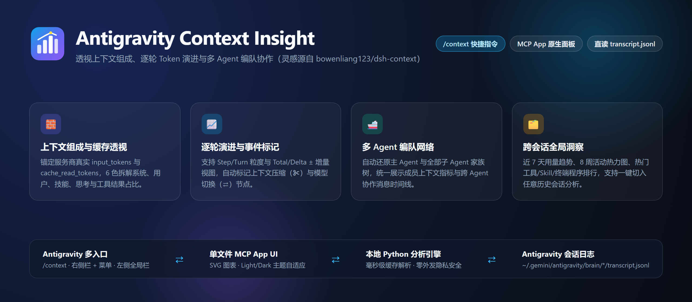
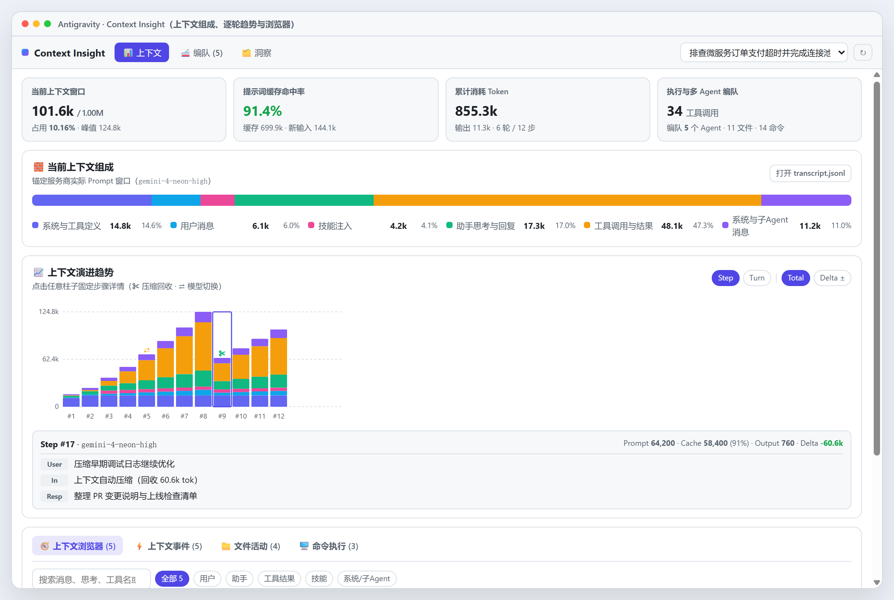
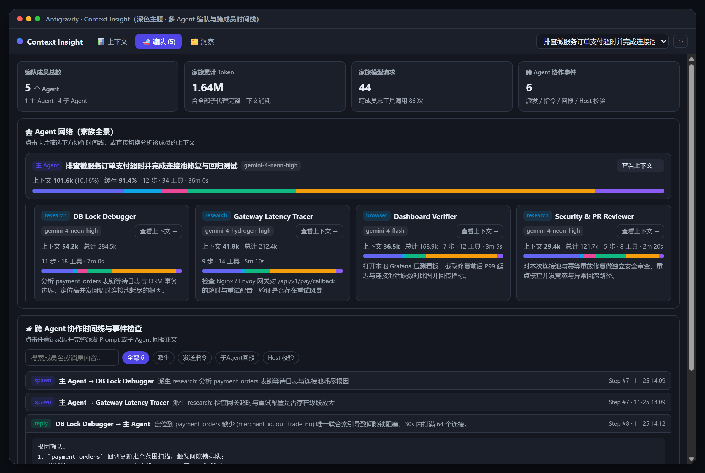
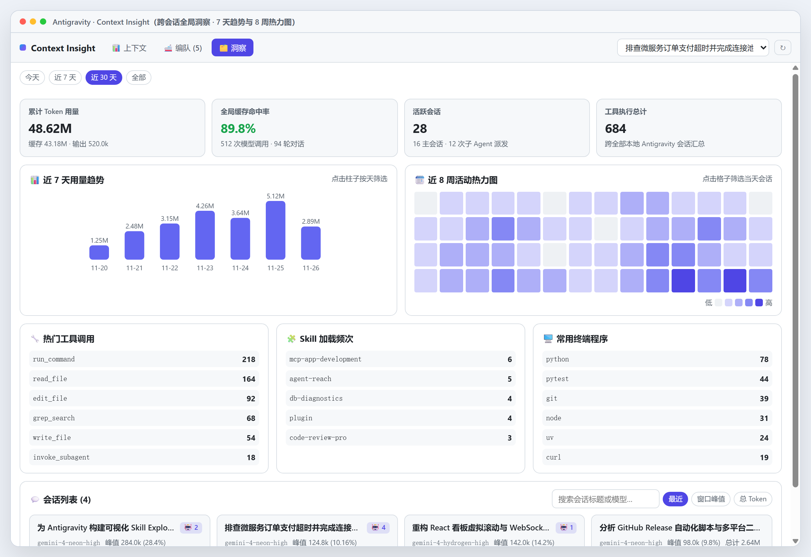

<p align="center">
  
</p>

<h1 align="center">Antigravity Context Insight</h1>

<p align="center">
  <strong>Google Antigravity 上下文透视、Token 演进分析与多 Agent 编队协作插件（MCP App · SEP-1865）</strong>
</p>

> **原作者致谢与参考声明**：本项目的设计理念、视图划分（上下文 / 编队 / 洞察）与核心分析维度深度参考并致敬了 [@bowenliang123](https://github.com/bowenliang123) 开发的 DeepSeek Harness 官方推荐插件 [**bowenliang123/dsh-context**](https://github.com/bowenliang123/dsh-context)（Apache-2.0）。本项目面向 **Google Antigravity** 平台基于 Python MCP Server 与 `@modelcontextprotocol/ext-apps` 独立重新实现，直接解析 Antigravity 原生 `transcript.jsonl` 日志。

---

## 界面与功能预览

### 1. 📊 上下文（Context）— 组成透视、逐轮演进与明细浏览器

锚定服务商真实上报的 `input_tokens`、`cache_read_tokens` 与 `output_tokens`，以 6 色堆叠条展示当前上下文窗口组成，支持 **Step / Turn** 粒度与 **Total / Delta ±** 增量趋势图，自动标记 **✂ 上下文压缩** 与 **⇄ 模型切换**，点击任意柱子固定 3 行步骤摘要，并在下方浏览上下文条目、事件日志、文件活动与终端命令执行：



### 2. 🚢 编队（Fleet）— 多 Agent 家族网络与跨成员协作时间线（深色主题）

自动跟随 Antigravity 明暗主题；完整还原主 Agent 与全部子 Agent（`browser`、`research`、`image-generator` 等）的家族树与独立上下文占用，点击成员卡片可筛选下方跨 Agent 协作时间线，或一键切入查看该子 Agent 的独立上下文仪表板：



### 3. 🗂️ 洞察（Insights）— 跨会话全局统计、7 天趋势与 8 周热力图

一键汇总本机全部 Antigravity 历史会话，提供 `今天 / 近 7 天 / 近 30 天 / 全部` KPI 指标、近 7 天每日用量柱状图、近 8 周活动热力图（点击任意日期筛选当天会话）、热门工具 / Skill 加载 / 终端程序排行以及可搜索排序的会话卡片：



---

## 核心特性

- **三种原生入口**：
  - 右侧辅助栏 `+` 菜单 → **Context Insight**（在聊天旁实时查看）
  - 左侧全局导航栏 → **Context Insight**（全页大屏模式）
  - 聊天输入框键入 **`/context`** 快捷指令直接唤起
- **零侵入、本地直读**：直接读取 `~/.gemini/antigravity/brain/<conversation-id>/.system_generated/logs/transcript.jsonl`，带 mtime 内存缓存，毫秒级响应，数据全程留在本地、零外发。
- **文件活动侧栏联动**：在「文件活动」列表点击任意文件名，即可通过 Antigravity `toggle-aux-pane` 在侧栏打开源文件预览。
- **零前端构建依赖**：仓库已内置打包好的单文件 [ui/app.html](ui/app.html)，安装只需 Python 3.10+（或 `uv`）。

---

## 一键安装

### Windows (PowerShell)

```powershell
git clone https://github.com/wwwww-alt/antigravity-context-insight.git
cd antigravity-context-insight
powershell -ExecutionPolicy Bypass -File .\install.ps1
```

### macOS / Linux

```bash
git clone https://github.com/wwwww-alt/antigravity-context-insight.git
cd antigravity-context-insight
chmod +x ./install.sh && ./install.sh
```

安装脚本会自动：
1. 将插件文件复制到 `~/.gemini/config/plugins/agy-context/`（并在 Windows 上自动将 `skills/context/SKILL.md` 规范为 LF 换行符以确保 `/context` 生效）；
2. 创建独立 Python 虚拟环境 `.venv` 并安装 `requirements.txt`（`mcp>=2.0.0`、`pyyaml>=6.0`）；
3. 生成使用本机绝对路径的 `mcp_config.json`。

安装完成后 Antigravity 会自动发现插件（无需重启；若未立即出现可在 Customizations 页面刷新一下 MCP Server）。

## 重新构建前端 UI（开发用）

仅在修改 `ui/src/app.ts` 时需要：

```bash
cd ui
pnpm install   # 或 npm install
pnpm run build # 生成单文件 ui/app.html
```

## 目录结构

```text
antigravity-context-insight/
├── plugin.json                # Antigravity 插件清单
├── mcp_config.json.example    # MCP 服务配置示例（安装脚本自动生成 mcp_config.json）
├── analytics.py               # Antigravity transcript.jsonl 解析与多 Agent 聚合引擎
├── server.py                  # Python MCP App 服务端
├── requirements.txt           # Python 依赖
├── assets/logo.svg            # 插件图标
├── docs/screenshots/          # 界面与功能展示图（均基于模拟数据渲染）
├── skills/context/SKILL.md    # /context 快捷指令配套 Skill
├── ui/
│   ├── app.html               # 预编译单文件 HTML（含 @modelcontextprotocol/ext-apps）
│   ├── src/app.ts             # UI 源码
│   ├── build.mjs              # esbuild 打包脚本
│   └── package.json
├── install.ps1                # Windows 一键安装脚本
└── install.sh                 # macOS / Linux 一键安装脚本
```

## 原作者声明与致谢（Acknowledgements）

- 本插件深受 DeepSeek Harness 官方推荐上下文洞察插件 [**dsh-context**](https://github.com/bowenliang123/dsh-context)（作者：[@bowenliang123](https://github.com/bowenliang123)，许可证：Apache-2.0）启发，在其「上下文组成条、逐轮 Total/Delta 演进趋势、步骤三行摘要、多 Agent 编队（Fleet）协作视图、跨会话 7 天趋势与 8 周热力图以及 `/context` 快捷入口」等优秀产品设计基础上，针对 **Google Antigravity** 的日志格式与 MCP App 架构完成了独立适配与实现。
- 本项目与原项目相互独立，未直接拷贝原项目源代码；所有原始设计创意与功能灵感均归功于原作者 [@bowenliang123](https://github.com/bowenliang123) 及 `dsh-context` 社区，如果你使用 DeepSeek Harness，强烈推荐前往原仓库 [bowenliang123/dsh-context](https://github.com/bowenliang123/dsh-context) 点亮 ⭐。
